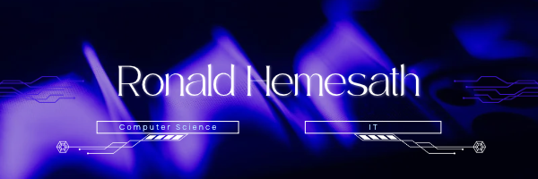

  

## 👋 Hi I'm Ronald!

Welcome to my GitHub profile! I'm Ronald, a Computer Science student at the University of Illinois Chicago (UIC), driven by a longstanding interest in computers, technology, and understanding how things work behind the scenes.

From building my first PC in 2018 to exploring computer networks, hardware, and software development, my curiosity about technology has continued to grow. I'm passionate about expanding my technical knowledge, developing practical solutions, and exploring the intersection of software and hardware.

I'm currently pursuing my Bachelor of Science in Computer Science, working toward a future in software engineering, embedded systems, firmware, and information technology.
